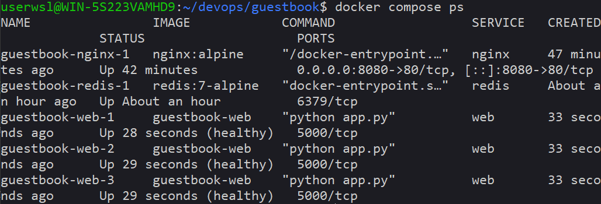
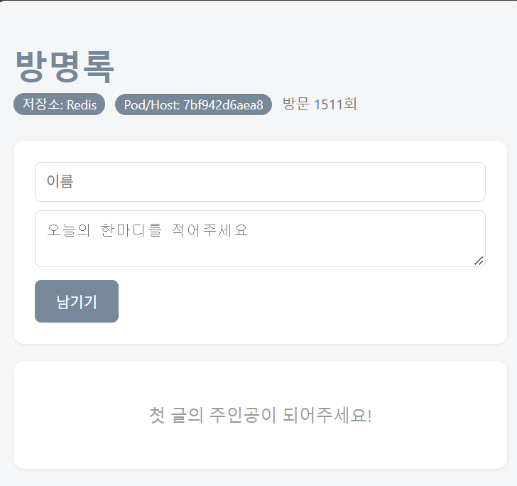
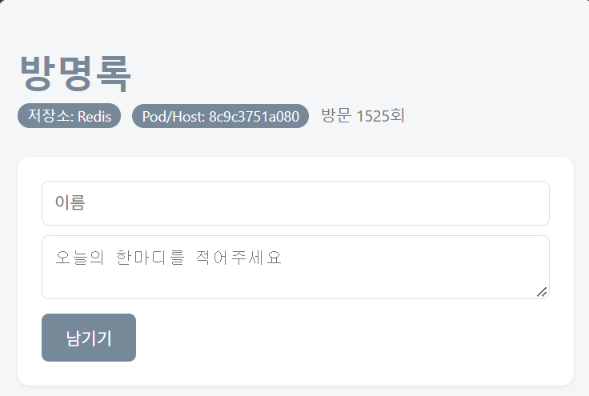
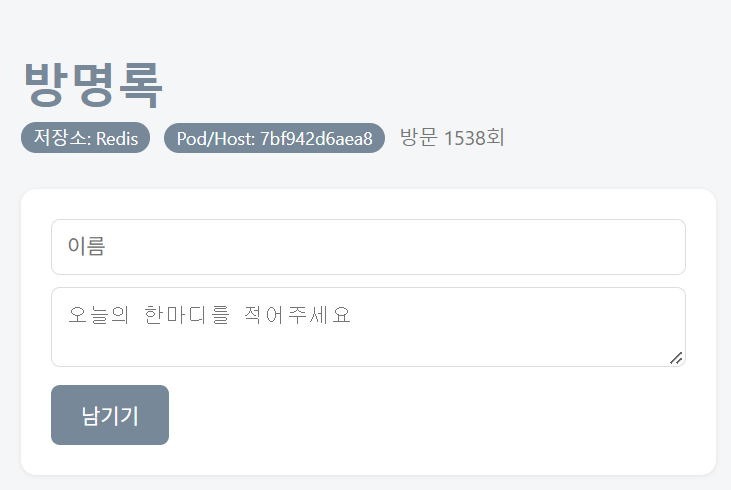
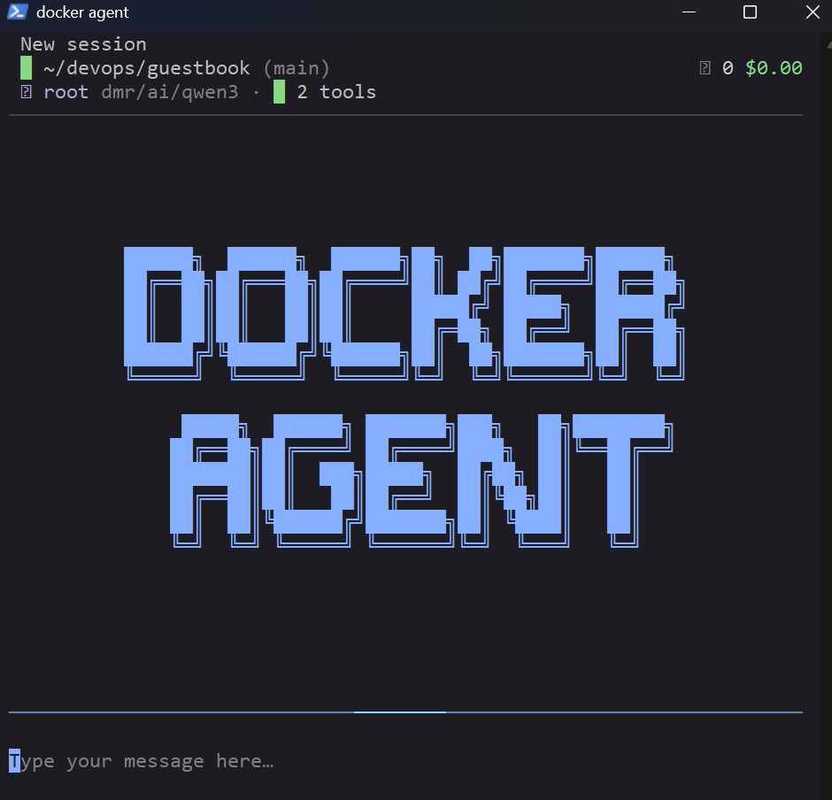

# Week 07 - 도커 컴포즈 (Docker Compose)

방명록(guestbook) 앱과 Redis를 각각 다른 컨테이너로 분리하고, 도커 컴포즈로 함께 실행했다.
앞에는 nginx를 두어 web 3개에 요청을 나눠 주도록 구성했다.

## 구성

```
브라우저 :8080
     │
 [nginx]            ports 8080:80, 리버스 프록시 + 로드 밸런싱
     │
 [web] [web] [web]  --scale web=3, expose 5000 (외부 노출 X), healthcheck /readyz
     │
 [redis]            ports 없음 (내부에서만 접근), 비밀번호는 .env, 볼륨 redis-data
```

| 파일 | 역할 |
|---|---|
| `guestbook/compose.yaml` | nginx, web, redis 서비스와 redis-data 볼륨 정의 |
| `guestbook/nginx.conf` | 8080으로 들어온 요청을 `web:5000`으로 전달 (도커 내부 DNS 사용) |
| `guestbook/.env.example` | 필요한 환경 변수 이름만 알려주는 양식 |
| `guestbook/.env` | 실제 비밀번호 (Git에 올리지 않음) |

## 실행 방법

```bash
cd ~/devops/guestbook
cp .env.example .env              # .env에 실제 비밀번호 작성
docker compose config --quiet && echo OK
docker compose up -d --scale web=3
```

## 1. docker compose ps 결과 (healthy 포함)



- redis와 web 모두 `(healthy)` 상태이다.
- redis가 healthy가 된 후에 web이 시작되고, web이 healthy가 된 후에 nginx가 시작된다 (`condition: service_healthy`).

## 2. scale 후 호스트명(컨테이너 ID) 변경 확인

`docker compose up -d --scale web=3` 실행 후 http://localhost:8080 을 3번 새로고침했다.

| 1회 | 2회 | 3회 |
|---|---|---|
|  |  |  |

- 새로고침할 때마다 화면의 Pod/Host 값(컨테이너 ID)이 바뀐다. nginx가 요청을 web 3개에 돌아가며 나눠 주기 때문이다.
- 어느 web이 응답해도 방명록 글은 똑같다. 데이터는 하나의 redis에 저장되어 있기 때문이다.

## 3. down 후 up vs down -v 후 up 비교

| 명령 | 지워지는 것 | 방명록 글 |
|---|---|---|
| `docker compose down` → `up -d` | 컨테이너, 네트워크 | **남아있음** |
| `docker compose down -v` → `up -d` | 컨테이너, 네트워크, **볼륨** | **사라짐** |

- redis는 `/data`에 데이터를 저장하고, `/data`는 `redis-data` 볼륨에 연결되어 있다.
- `down`은 볼륨을 지우지 않기 때문에 컨테이너를 새로 만들어도 같은 볼륨이 다시 연결되어 글이 남아있다.
- `down -v`는 볼륨까지 지우기 때문에 데이터도 함께 사라진다.
- 운영 환경에서 `-v`를 잘못 쓰면 중요한 데이터가 삭제되므로 주의해야 한다.

## 4. .env를 Git에 올리지 않는 이유

- `.env`에는 비밀번호 같은 Secret 값이 들어 있다. GitHub에 올리면 누구나 볼 수 있다.
- 나중에 파일에서 지워도 Git 이력(commit history)에 남아 있어서 다시 찾아볼 수 있다.
- 그래서 설정 파일(`compose.yaml`)에는 값 대신 `${REDIS_PASSWORD}`만 적고, 실제 값은 내 컴퓨터의 `.env`에만 둔다.
- `.gitignore`에 `.env`를 추가해서 실수로 커밋하는 것을 막고, `.dockerignore`에도 있어서 이미지 안에도 복사되지 않는다.
- 다른 사람에게는 `.env.example`로 어떤 변수가 필요한지만 알려준다.
- `.gitignore`는 암호화가 아니라 Git이 파일을 무시하게 하는 것뿐이다.

## 5. 도커 에이전트 (Docker Agent) 시연

`guestbook/agent.yaml`로 방명록 compose 도우미 에이전트를 만들어 실행했다.

```bash
cd ~/devops/guestbook
docker model pull ai/qwen3
docker agent run --safety strict agent.yaml "지금 compose 상태를 확인하고, 문제가 있으면 설명해줘"
```



- 에이전트에게 `shell` 도구를 주면 내 컴퓨터에서 명령을 실행하므로, `instruction`에 컨테이너나 볼륨을 지우는 명령(`down -v`, `rm`, `volume rm`)은 실행하지 않도록 적었다.
- API 키는 `agent.yaml`에 적지 않는다 (환경 변수 또는 `.env` + `--env-from-file`).

## 배운 점

- 컨테이너 하나 = 역할 하나. 앱과 DB를 나누니 web을 재시작해도 글이 남는다.
- 같은 네트워크에서는 서비스 이름이 곧 DNS 주소이다 (`REDIS_HOST: "redis"`).
- `ports:`가 없는 서비스(redis)는 호스트에서 직접 접속할 수 없다.
- `depends_on`은 시작 순서만 보장하고, 준비 완료는 `healthcheck` + `service_healthy`로 확인한다.
- `docker compose config`로 띄우기 전에 YAML과 환경 변수를 미리 검사할 수 있다.
- 컴포즈는 컴퓨터 한 대 안에서만 동작한다. 여러 서버와 자동 복구는 Kubernetes의 영역이다.
