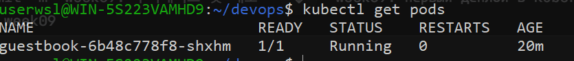
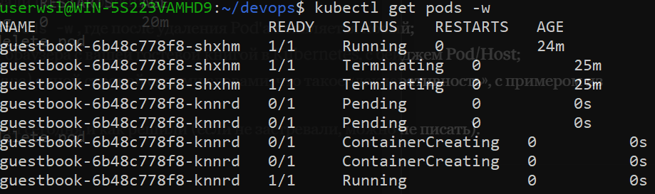
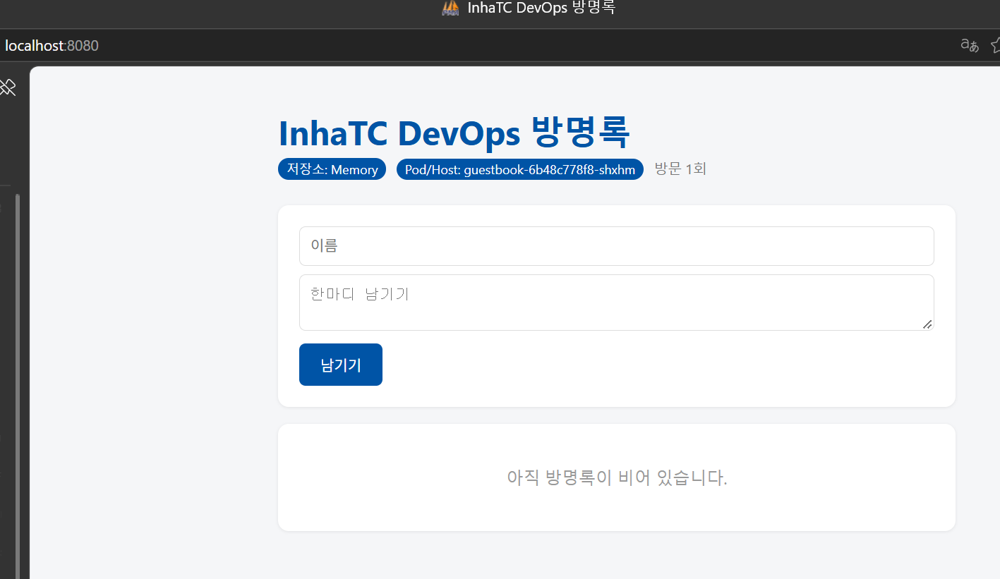

# Week 09 - 쿠버네티스 첫 배포

## 사용한 도구

- kubectl + **minikube** (`--driver=docker`)

## 1. 클러스터 확인 (`kubectl get nodes`)



- `minikube` 노드가 **Ready** 상태, 역할은 `control-plane`

## 2. 자가 치유 (`kubectl get pods -w`)



- `kubectl create deployment`로 Pod 3개를 선언
- Pod 하나를 `kubectl delete pod`로 삭제 → `Terminating`
- 쿠버네티스가 새 Pod를 생성 (`Pending` → `ContainerCreating` → `Running`)
- 새 Pod는 이름 끝이 다름 → 되살린 것이 아니라 새로 만든 것

## 3. 내 방명록을 쿠버네티스에서 실행



```bash
kubectl create deployment guestbook --image=ghcr.io/yuuhwn/guestbook:v1
kubectl port-forward deployment/guestbook 8080:5000
```

- 브라우저에서 `http://localhost:8080` 접속
- 배지의 **Pod/Host** 값이 실행 중인 Pod 이름과 일치
