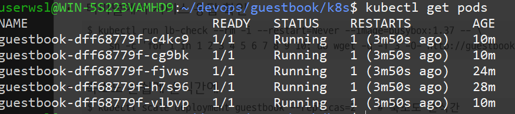
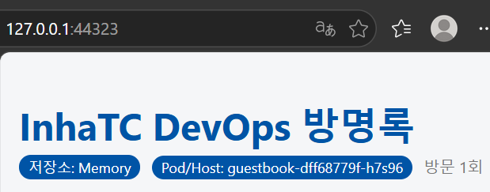
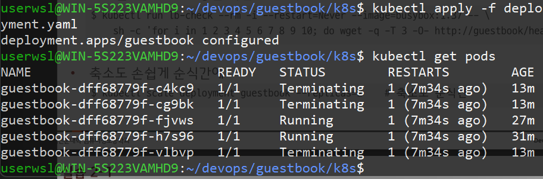
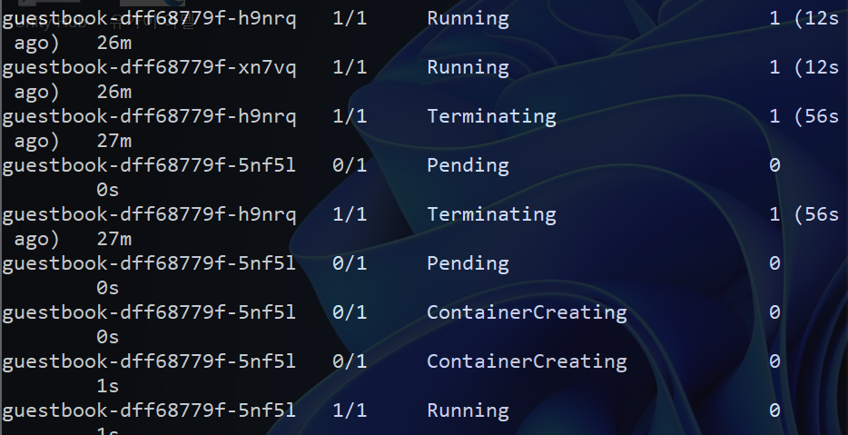
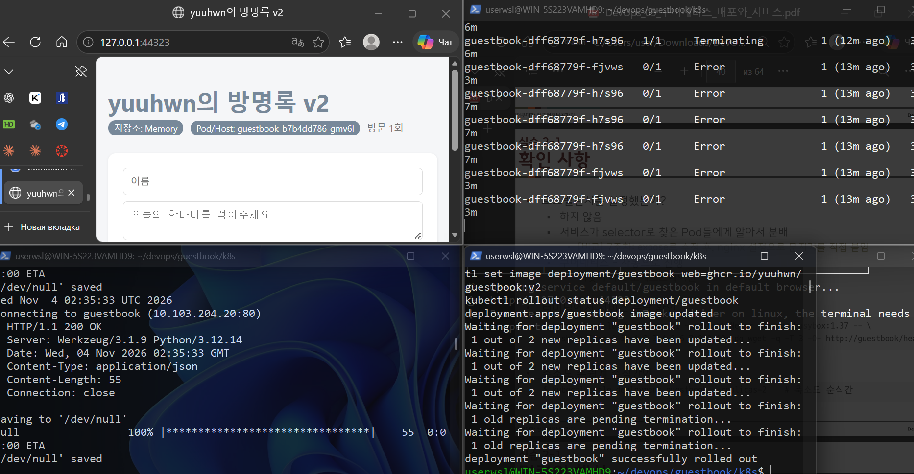
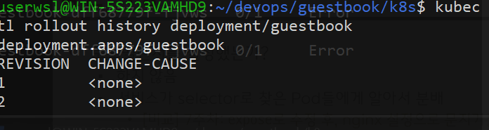
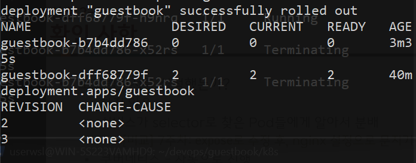
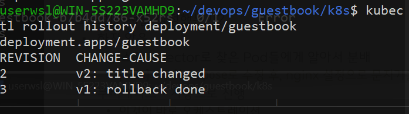

# Week 10 - Deployment와 Service

## 환경

- kubectl + **minikube** (`--driver=docker`)
- 이미지: `ghcr.io/yuuhwn/guestbook:v1`, `ghcr.io/yuuhwn/guestbook:v2`
- 매니페스트: `guestbook/k8s/deployment.yaml`, `guestbook/k8s/service.yaml`

```bash
kubectl apply -f k8s/deployment.yaml   # Deployment (replicas: 2)
kubectl apply -f k8s/service.yaml      # Service (NodePort 30080 → 80 → 5000)
minikube service guestbook
```

## 1. replicas를 5로 늘리기

```bash
kubectl scale deployment guestbook --replicas=5
kubectl get pods
```



- Pod 5개 모두 `Running`
- 이름 가운데 `dff68779f`가 모두 같음 → 같은 ReplicaSet(같은 template)에서 만들어진 Pod

## 2. 서비스를 통과한 요청의 Pod hostname

브라우저에서 새로고침할 때마다 **Pod/Host** 배지가 바뀜.

| 캡처 | Pod/Host |
|---|---|
|  | `guestbook-dff68779f-h7s96` |
|  | `guestbook-dff68779f-c4kc9` |
|  | `guestbook-dff68779f-cg9bk` |
|  | `guestbook-dff68779f-fjvws` |

- 로드밸런서를 따로 설정하지 않았지만, Service가 `selector: app=guestbook`으로 찾은 Pod들에게 요청을 나눠 보냄
- 저장소가 Memory라서 Pod마다 데이터가 달라 방문 횟수와 글이 바뀌어 보임

### apply로 다시 2개로

```bash
kubectl apply -f k8s/deployment.yaml
```



- 파일에는 `replicas: 2` → 파일과 클러스터가 다르면 apply는 파일 쪽에 맞춤 → 3개 `Terminating`

## 3. Pod 강제 삭제 → 자동 생성 (자가 치유)

```bash
kubectl get pods -w                    # 터미널 A
kubectl delete pod <Pod 이름>           # 터미널 B
```



- 삭제한 Pod는 `Terminating`, 새 Pod가 바로 `Pending → ContainerCreating → Running`
- 새 Pod는 이름 끝 5글자가 다름 → 되살린 것이 아니라 같은 틀(template)로 새로 만든 것

## 4. v1 → v2 롤링 업데이트

```bash
docker build -t ghcr.io/yuuhwn/guestbook:v2 .
docker push ghcr.io/yuuhwn/guestbook:v2
kubectl set image deployment/guestbook web=ghcr.io/yuuhwn/guestbook:v2
kubectl rollout status deployment/guestbook
```



- 왼쪽 위: 브라우저 제목이 **yuuhwn의 방명록 v2**, Pod/Host가 새 ReplicaSet(`b7b4dd786`)의 Pod
- 오른쪽 위 (`get pods -w`): v1 Pod(`dff68779f`)가 하나씩 종료
- 왼쪽 아래 (`rollout-check`): 교체 중에도 계속 `HTTP/1.1 200 OK` → 서비스 중단 없음
- 오른쪽 아래: `1 out of 2 new replicas have been updated...` → `successfully rolled out`

```bash
kubectl rollout history deployment/guestbook
```



- REVISION 1 = v1, REVISION 2 = v2

## 5. 롤백

```bash
kubectl rollout undo deployment/guestbook
kubectl rollout status deployment/guestbook
kubectl get rs
kubectl rollout history deployment/guestbook
```



- `guestbook-dff68779f`(v1) → 다시 `2 2 2`, `guestbook-b7b4dd786`(v2) → `0 0 0`
- 코드를 되돌리거나 다시 빌드하지 않음 → 0개로 남아 있던 이전 ReplicaSet을 다시 살림
- REVISION 1이 사라지고 3이 생김 → 되돌리면 새 번호가 붙고 기록은 쌓임 (`git revert`와 비슷)

### 변경 이유 남기기

```bash
kubectl annotate deployment/guestbook kubernetes.io/change-cause="v1: rollback done"
kubectl annotate rs guestbook-b7b4dd786 kubernetes.io/change-cause="v2: title changed" --overwrite
kubectl rollout history deployment/guestbook
```



## 막혔던 것과 해결

- **`connection refused` (127.0.0.1:57312)**: 클러스터가 꺼져 있었음 → Docker Desktop 실행 후 `minikube start --driver=docker`
- **`deployment.yaml`의 image가 `ghcr.io/내아이디/...`**: 실습 자료 그대로라 이미지를 받을 수 없음 → `ghcr.io/yuuhwn/...`으로 수정 (ghcr.io는 소문자만 가능)
- **`missing the kubectl.kubernetes.io/last-applied-configuration annotation` 경고**: 지난주 `kubectl create`로 만든 Deployment가 남아 있었음 → `kubectl delete deployment guestbook` 후 `apply`로 새로 생성
- **롤링 업데이트 중 v1 Pod 상태가 `Error`**: 종료 신호(SIGTERM)를 받은 Flask 프로세스가 0이 아닌 코드로 끝나서 잠깐 `Error`로 표시됨. 새 Pod가 이미 요청을 받고 있었기 때문에 `rollout-check`는 계속 `200 OK`

## 선언형을 내 언어로

> 명령형은 "Pod 하나 만들어"를 내가 계속 시키는 것이고, 선언형은 `replicas: 2`처럼 원하는 상태만 파일에 적어 두는 것이다.
> 파일이 기준이기 때문에 `scale`로 5개를 만들어도 `apply`하면 다시 2개가 된다. 그래서 변경은 파일 + Git으로 남겨야 "왜 지금 이 개수인지"를 알 수 있다.
