# Week 11 - ConfigMap, Secret, Probe

## 환경

- kubectl + **minikube** (`--driver=docker`)
- 매니페스트: `guestbook/k8s/`

```
guestbook/k8s/
├── deployment.yaml         # envFrom + resources + livenessProbe/readinessProbe
├── service.yaml            # NodePort 30080
├── configmap.yaml          # APP_TITLE, THEME_COLOR, REDIS_HOST, REDIS_PORT
├── secret.yaml             # 실제 비밀번호 (.gitignore, Git에 올리지 않음)
├── secret.yaml.example     # CHANGE_ME (Git에 올리는 견본)
└── redis.yaml              # Redis Deployment + ClusterIP Service
```

## 1. ConfigMap / Secret 만들기

```bash
kubectl apply -f k8s/configmap.yaml
kubectl apply -f k8s/secret.yaml
kubectl get cm,secret
```

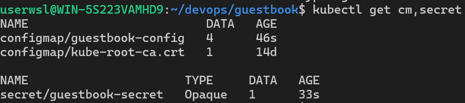

- `guestbook-config`: DATA 4개 (APP_TITLE, THEME_COLOR, REDIS_HOST, REDIS_PORT)
- `guestbook-secret`: TYPE `Opaque`, DATA 1개 (REDIS_PASSWORD)

## 2. Secret은 안전하지 않다 (base64 -d)

```bash
kubectl get secret guestbook-secret -o yaml | grep REDIS_PASSWORD
kubectl get secret guestbook-secret -o jsonpath='{.data.REDIS_PASSWORD}' | base64 -d; echo
```

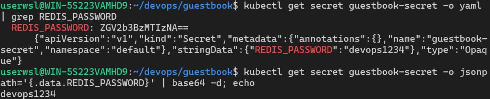

- `-o yaml`에 보이는 `ZGV2b3BzMTIzNA==`는 암호가 아니라 **base64로 바꿔 적은 글자**
- `base64 -d` 한 번이면 누구나 `devops1234`로 되돌릴 수 있음 (열쇠가 필요 없음)
- 게다가 `kubectl apply`로 만들면 `last-applied-configuration` 주석에 `stringData`가 **평문 그대로** (`"REDIS_PASSWORD":"devops1234"`) 남음 → base64 -d조차 필요 없음
- 인코딩 = 표기 방식만 바꾼 것 / 암호화 = 열쇠가 있어야 풀림 / 해시 = 되돌릴 수 없음
- Secret의 장점은 `kubectl get` 화면에 바로 안 보이고 설정과 비밀을 나눠 관리한다는 정도
- 그래서 `secret.yaml`은 `.gitignore`에 넣고, Git에는 `CHANGE_ME`가 들어간 `secret.yaml.example`만 올림

## 3. Redis 배포 + 방명록에 설정 주입

```bash
kubectl apply -f k8s/redis.yaml        # Deployment + Service(ClusterIP)
kubectl apply -f k8s/deployment.yaml   # envFrom: configMapRef + secretRef
kubectl get pods,svc
```

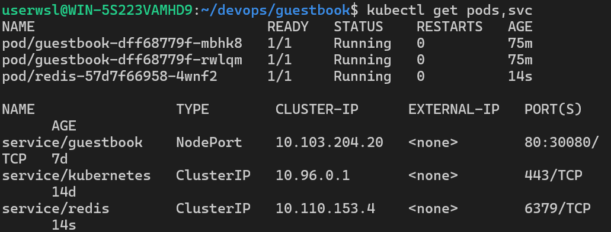

- `redis` Service는 ClusterIP → 클러스터 안에서만 `redis:6379`로 접근
- `guestbook`은 NodePort → 바깥에서 접속

| 연결 직후 | 글 작성 후 새로고침 |
|---|---|
| 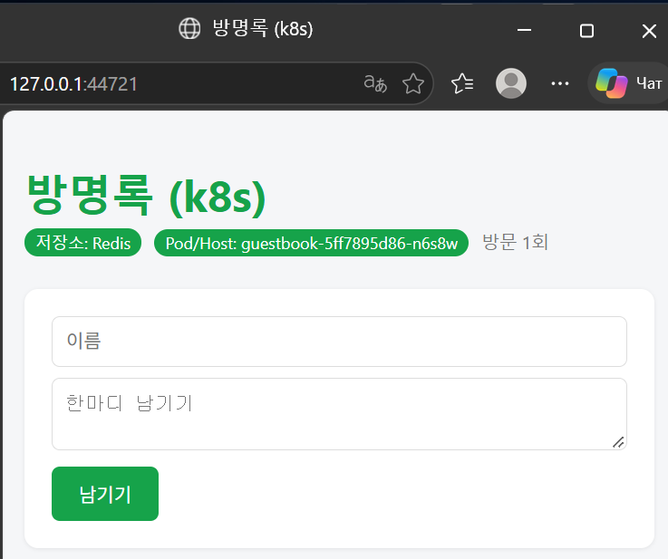 | 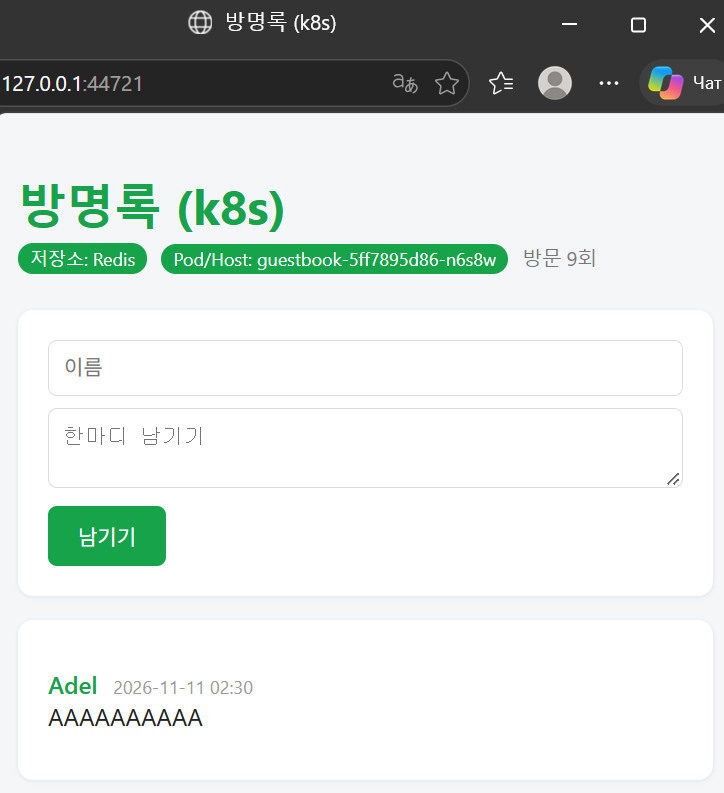 |

- 저장소 배지가 **Memory → Redis**로 바뀜
- 제목 `방명록 (k8s)`, 초록색 → ConfigMap 값이 환경 변수로 들어감
- 새로고침해도 글이 사라지지 않음 → 모든 Pod가 같은 Redis 사용 (**무상태 앱 + 공유 DB**)
- 지난주 Memory 모드의 "글이 보였다 안 보였다" 문제 해결

## 4. ConfigMap만 바꿔서 제목과 색 변경

```bash
kubectl edit configmap guestbook-config
# APP_TITLE: "New 방명록 (k8s)", THEME_COLOR: "#e11d48"
kubectl rollout restart deployment guestbook
kubectl rollout status deployment guestbook
```

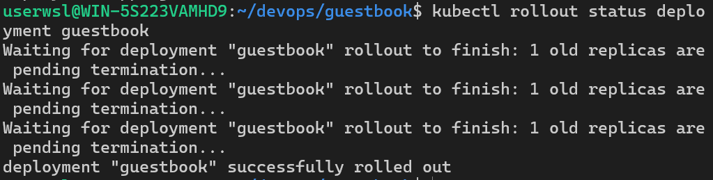

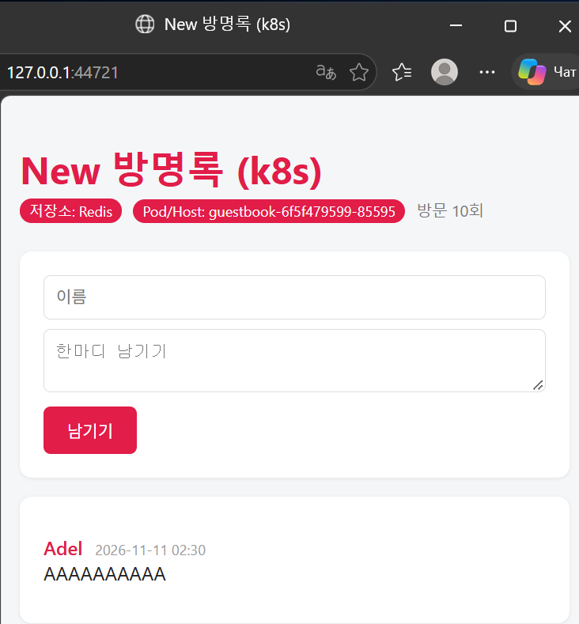

- 제목 **New 방명록 (k8s)**, 색 초록 → 빨강
- 이미지 다시 빌드 X / 코드 수정 X / 방명록 글 그대로 (Redis에 저장되어 있으니까)
- Pod/Host 이름이 바뀜 → `rollout restart`로 새 Pod가 뜨면서 새 환경 변수를 읽음
- ConfigMap을 고쳐도 이미 떠 있는 Pod는 옛 값을 그대로 씀 (환경 변수는 프로세스 시작 시 정해짐) → restart 필요
- `kubectl edit`은 Git과 YAML 파일에 남지 않음 → 실제로는 `configmap.yaml` 수정 + `apply` + 커밋

## 5. readiness 실패 실험 (READY 0/1)

```bash
kubectl get pods -w                         # 터미널 A
kubectl scale deployment redis --replicas=0 # 터미널 B
```

| Redis 종료 | guestbook READY 0/1 |
|---|---|
| 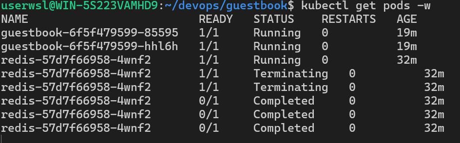 | 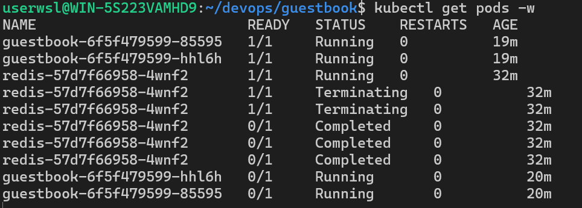 |

```bash
kubectl exec deployment/guestbook -- python -c \
"import urllib.request as u; print(u.urlopen('http://localhost:5000/readyz').read())"
```

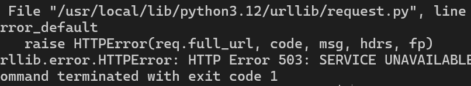

- guestbook Pod는 STATUS `Running`인데 READY `0/1`
- `/readyz`가 **503 SERVICE UNAVAILABLE** → readinessProbe 실패
- 쿠버네티스가 이 Pod들을 서비스 명단에서 빼서 요청을 보내지 않음
- **재시작은 하지 않음** (RESTARTS 0 그대로)
- `kubectl scale deployment redis --replicas=1` → 자동으로 READY 1/1 복귀

## 6. liveness 실패 실험 (RESTARTS 증가)

```bash
kubectl patch deployment guestbook -p '{"spec":{"template":{"spec":{"containers":[{"name":"web","livenessProbe":{"httpGet":{"path":"/devops","port":5000},"periodSeconds":5,"failureThreshold":2}}]}}}}'
kubectl get pods -w
kubectl describe pod <Pod 이름> | grep -i liveness
```

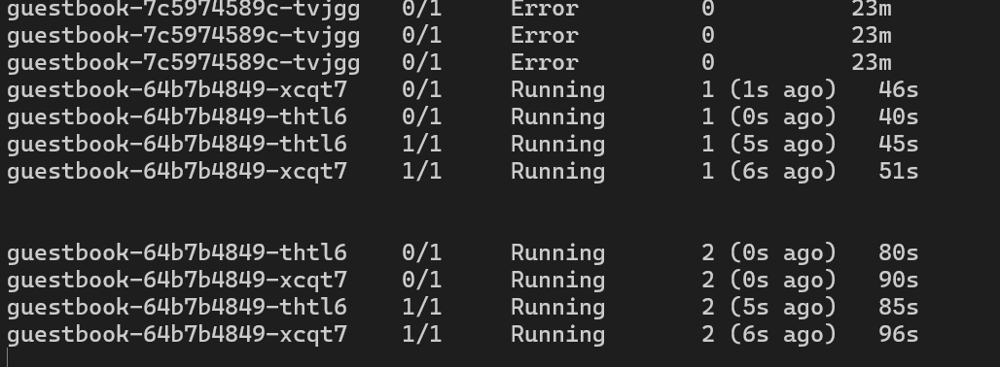

- 일부러 없는 경로 `/devops` → 404 → livenessProbe 실패
- kubelet이 컨테이너를 계속 재시작 → **RESTARTS 숫자가 계속 올라감** (`1 (1s ago)` → `2 (0s ago)`)
- 재시작 직후 잠깐 READY `0/1`, readiness 통과 후 `1/1` → 다시 liveness 실패로 재시작 (반복)
- 위쪽 `Error`는 patch로 template이 바뀌면서 정리된 이전 ReplicaSet의 Pod
- Events: `Liveness probe failed: HTTP probe failed with statuscode: 404`
- 앱은 멀쩡한데 probe 경로 하나 틀려서 계속 죽음 → probe 설정도 코드처럼 확인해야 함
- 원복: `kubectl apply -f k8s/deployment.yaml`

| | readiness 실패 | liveness 실패 |
|---|---|---|
| 질문 | "요청 받을 준비 됐니?" | "살아 있니?" |
| 화면 | READY `0/1`, RESTARTS 그대로 | READY `1/1`→`0/1` 반복, RESTARTS 증가 |
| 쿠버네티스 동작 | 서비스에서 트래픽 차단 | 컨테이너 재시작 |

## 7. 트러블슈팅 3단 루틴 (내 언어로)

1. **`kubectl get pods`** - 어디가 아픈지 먼저 본다. STATUS, READY, RESTARTS 세 칸만 봐도 방향이 나온다.
   READY 0/1이면 readiness, RESTARTS가 오르면 liveness나 앱 오류, ConfigError면 이름 오타를 의심한다.
2. **`kubectl describe pod <이름>`** - 맨 아래 Events를 읽는다. 쿠버네티스가 Pod에게 한 일과 실패 이유가 시간 순서로 적혀 있다.
   Pod가 시작도 못 했으면(ImagePull, ConfigError) 여기서 답이 나온다.

   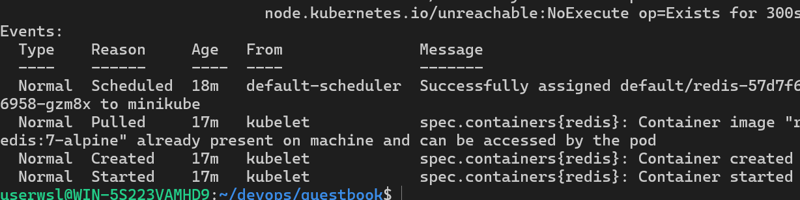

   정상이면 `Scheduled → Pulled → Created → Started` 순서로 이어진다.
3. **`kubectl logs <이름>`** - 컨테이너가 켜졌다 죽는 경우는 앱이 남긴 에러를 본다. CrashLoopBackOff라면 `--previous`로 죽기 직전 로그를 본다.

> 한 줄 요약: **상태(get) → 쿠버네티스 입장(describe) → 앱 입장(logs)** 순서로 증거를 모은다.
> AI에게 물어볼 때도 이 순서로 모은 결과를 주면 되고, Secret 값이나 printenv 전체는 지우고 붙여 넣는다.

## 8. Secret을 Git에서 빼기

```bash
git ls-files guestbook/k8s/secret.yaml      # 아무것도 안 나오면 추적 안 되는 상태
cp guestbook/k8s/secret.yaml guestbook/k8s/secret.yaml.example
# secret.yaml.example의 비밀번호를 "CHANGE_ME"로 변경
echo "guestbook/k8s/secret.yaml" >> .gitignore
```
