# Week 12 - GitHub Actions (CI)

## 만든 것

```
devops/
├── .github/workflows/build.yml     # CI 워크플로
└── guestbook/
    └── tests/test_app.py           # 앱 동작 테스트 (/healthz, 글 등록·조회)
```

| 트리거 (`on`) | 하는 일 |
|---|---|
| `pull_request` → main | 린트 → 테스트 → 이미지 빌드 (**푸시 안 함**) |
| `push` → main (`guestbook/**`, `build.yml` 변경 시) | 린트 → 테스트 → 빌드 → **ghcr.io 푸시** |
| `workflow_dispatch` | Actions 탭 / `gh workflow run`으로 수동 실행 |

- 러너: `ubuntu-latest` (깃허브가 빌려 주는 서버, job마다 새로 시작)
- 권한: `contents: read`, `packages: write` / 로그인은 `secrets.GITHUB_TOKEN` (자동 발급)
- 이미지 태그: 커밋 해시 7자리 + main일 때만 `latest`
- 플랫폼: `linux/amd64`, `linux/arm64`

## 0. 푸시 전 로컬 확인

```bash
cd ~/devops/guestbook
docker run --rm -v "$PWD":/app -w /app -e PYTHONDONTWRITEBYTECODE=1 python:3.12-slim \
  sh -c "pip install -q ruff -r requirements.txt && ruff check . --select=E9,F --no-cache \
  && python -m unittest discover -s tests -v"
```

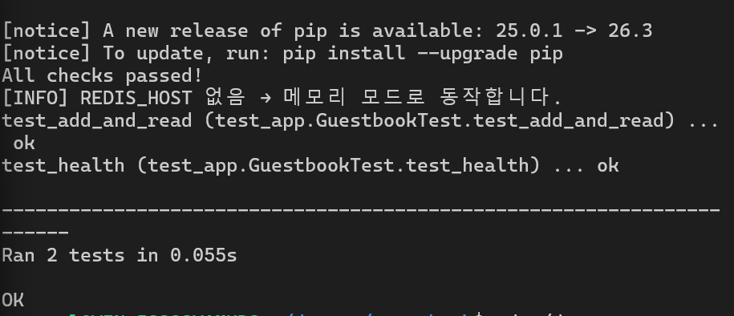

- 린트 `All checks passed!`, 테스트 2개 `ok` → CI에서 할 일을 컨테이너로 먼저 재현

| ruff 종료 코드 | 변경 확인용 문구 |
|---|---|
| 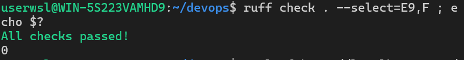 | 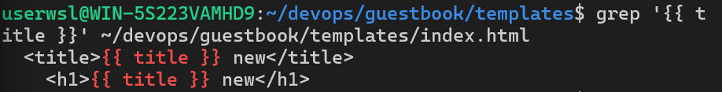 |

- `echo $?` → `0` = 성공 (깃허브 액션도 이 값만 보고 초록✓/빨간X 결정)
- `index.html`의 `{{ title }} v2` → `{{ title }} new`

## 1. main에서 CI 성공 → 이미지 자동 게시

```bash
gh run watch
```

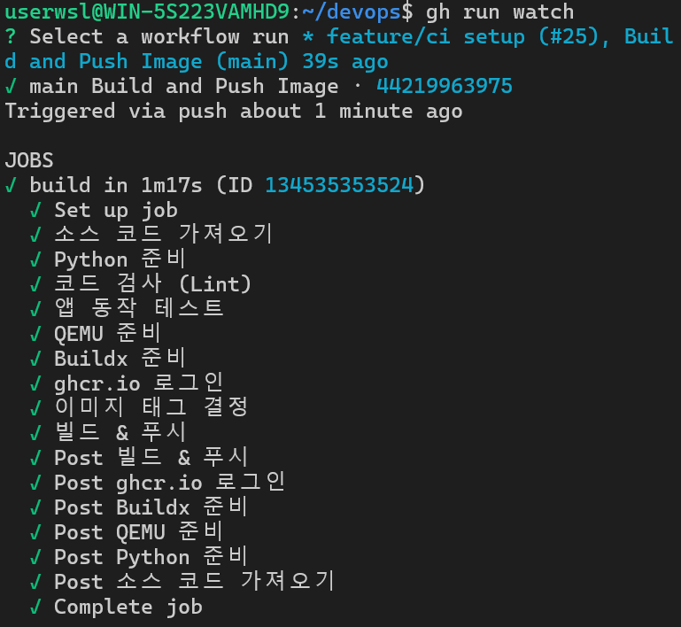

- 트리거: `push` (feature/ci-setup PR 머지)
- 소스 가져오기 → Python → **Lint** → **테스트** → QEMU/Buildx → ghcr.io 로그인 → 태그 결정 → **빌드 & 푸시** 전부 초록✓
- 나는 `docker build`, `docker push`를 하지 않았음. 한 일은 `git push`, PR, 머지뿐

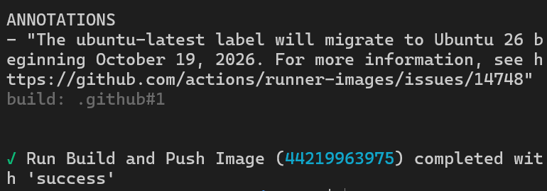

- 경고: `ubuntu-latest`가 Ubuntu 26으로 바뀌는 중 → 갑자기 실패하면 `runs-on: ubuntu-24.04`로 고정해서 비교

## 2. CI가 만든 이미지를 쿠버네티스에 배포

```bash
kubectl set image deployment/guestbook web=ghcr.io/yuuhwn/guestbook:74270fb
kubectl rollout status deployment/guestbook
```

| 배포 | 이미지 확인 |
|---|---|
| 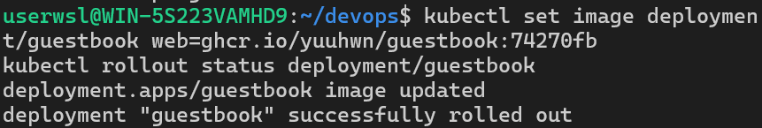 | 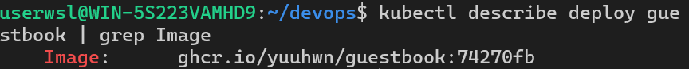 |

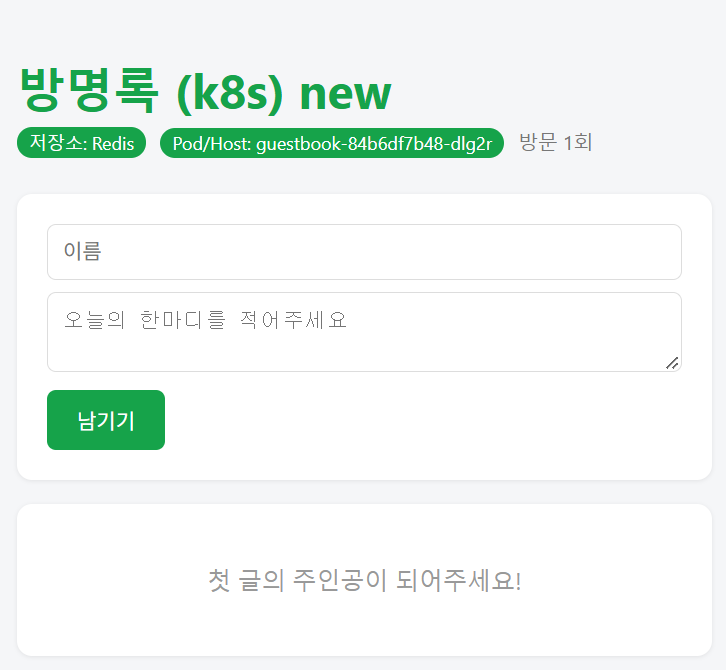

- 태그 `74270fb` = CI 워크플로가 들어간 머지 커밋의 해시 → "이 이미지는 이 커밋으로 만들었다"를 추적 가능
- 제목 `방명록 (k8s) new` → `index.html`에서 `v2`를 `new`로 바꾼 코드가 들어간 이미지
- 저장소 Redis, ConfigMap(제목·색)은 지난주 설정 그대로 유지

## 3. 빨간X → 초록✓ (일부러 고장내기)

`feature/ci-errors` 브랜치에서 PR을 열고 세 번 고장 냈다.

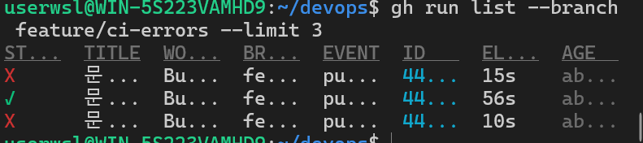

### 3-1. 문법 오류 - `def broken(:`

- **코드 검사 (Lint)** 단계에서 `invalid-syntax` → `exit code 1` → 빨간X
- 뒤의 빌드 & 푸시 단계는 실행되지 않음 → 깨진 이미지가 만들어지지 않음
- 마지막 줄 삭제 후 푸시 → 초록✓

### 3-2. 오타 - `print(APP_TITL)` (린트)

```bash
python3 -m compileall guestbook/app.py; echo $?   # 0 → 문법 검사는 통과
```

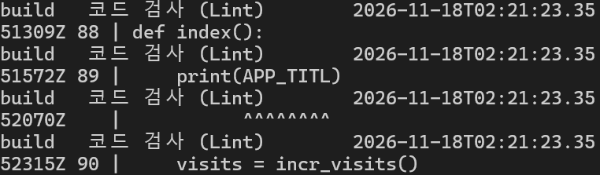

- `compileall`은 통과시켰지만 ruff가 `F821 Undefined name 'APP_TITL'`로 잡음 (`app.py:89`)
- 그대로 배포됐다면 첫 화면에 접속할 때 **HTTP 500**

### 3-3. 앱 동작 오류 - `/healthz`가 500 반환 (테스트)

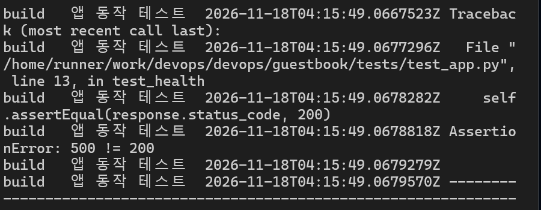

- 린트는 통과 (코드는 문법적으로도, 이름도 문제없음)
- 테스트 `test_health`에서 `AssertionError: 500 != 200`
- 그대로 배포됐다면 livenessProbe가 계속 실패 → 컨테이너 무한 재시작

| | 문법 검사 | 린트 | 테스트 |
|---|---|---|---|
| 묻는 것 | 파이썬이 읽을 수 있나? | 읽히는데 버그 가능성은? | 의도대로 동작하나? |
| 코드 실행 | X | X | O |
| 이번 실험 | `def broken(:` | `print(APP_TITL)` | `/healthz` → 500 |

- 순서: 싸고 빠른 검사부터 → 앞 단계가 실패하면 거기서 멈춤
- 테스트 통과 ≠ 버그 없음. 테스트한 부분만 보장함

## 4. main 브랜치 보호 (Require status checks: build)

Settings → Branches → `main` 규칙에 **Require status checks to pass before merging → `build`** 추가

### main에 직접 푸시 → 거부

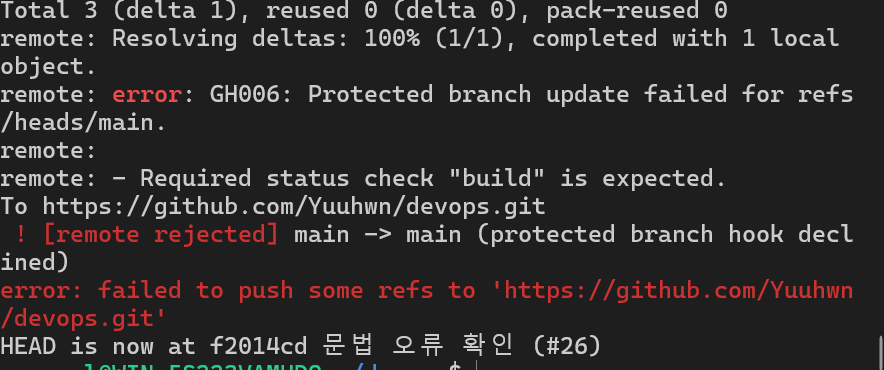

- `GH006: Protected branch update failed` / `Required status check "build" is expected.`

### 깨진 코드로 PR → 머지 차단

| PR 화면 | 체크 결과 |
|---|---|
| 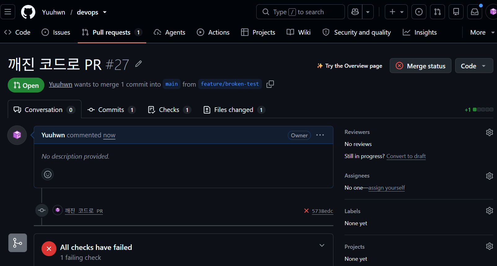 | 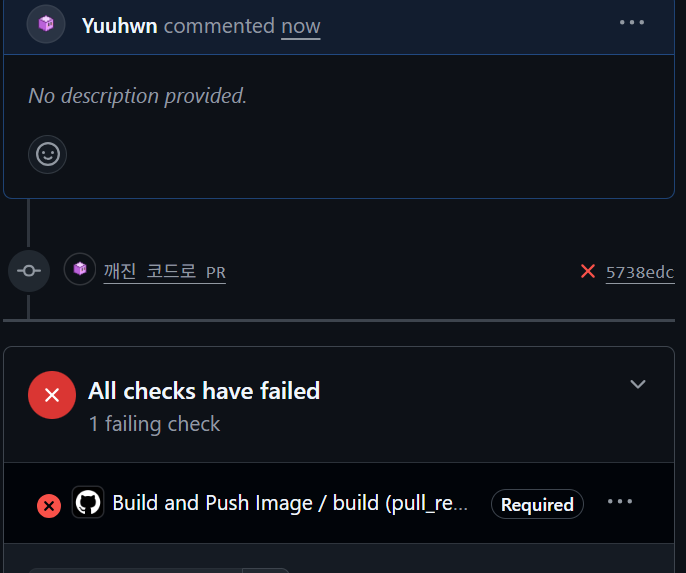 |

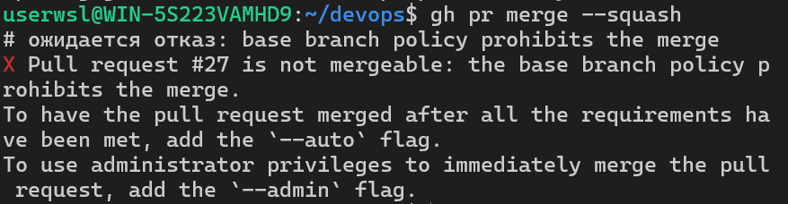

- `build` 체크에 **Required** 표시, `All checks have failed`
- `gh pr merge` → `the base branch policy prohibits the merge`
- 고친 커밋을 푸시해도 **체크가 끝나기 전에는** 머지 불가 → 초록✓ 이후 머지
- CI만으로는 머지를 막지 못함. **CI(검사) + 브랜치 보호(차단)** 둘 다 있어야 main이 지켜짐

## 막혔던 것과 해결

증상 → 확인 → 원인 → 조치 순서로 기록.

1. **Actions 탭이 비어 있음**
   - 확인: `gh pr list`, `git ls-files .github`, `gh auth status`
   - 원인: PR이 만들어지지 않아 워크플로가 실행될 이벤트가 없었음
   - 조치: `build.yml`을 저장소 루트 `.github/workflows/`에 다시 작성 → 커밋 → 푸시 → `gh pr create --fill`

2. **빌드 & 푸시에서 `denied: permission_denied: write_package`**
   - 확인: `gh run view --log-failed`
   - 원인: 6주차에 CLI로 만든 `guestbook` 패키지가 이 저장소와 연결되어 있지 않음
   - 조치: Package settings → Manage Actions access → `devops` 추가, Role **Write** → `gh run rerun --failed`

   | PR은 ✓, main 푸시는 ✗ | 실패한 job만 재실행 |
   |---|---|
   | 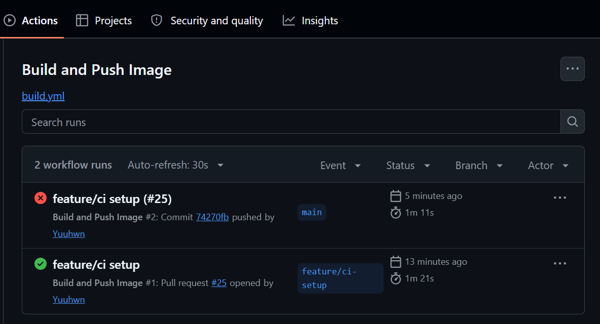 | 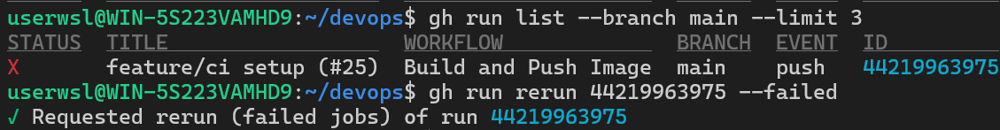 |

   - PR에서는 푸시를 안 하니까 통과, main에서 푸시할 때만 권한 문제가 드러남

3. **`gh pr checks`가 이전 결과 / `no checks reported`를 보여줌**
   - 원인: 푸시 직후에는 새 실행이 아직 등록되지 않음

     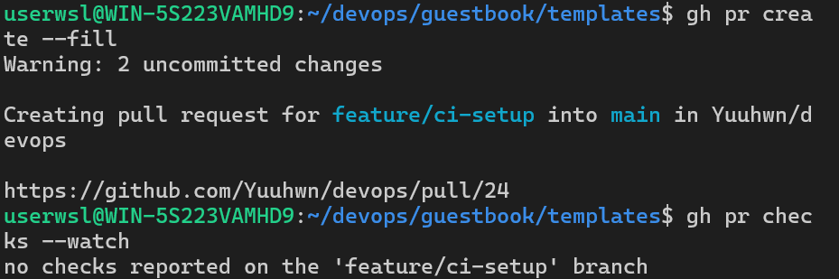

   - 조치: `sleep 15 && gh pr checks --watch`

4. **`kubectl set image`가 `1 out of 2 new replicas`에서 멈춤**
   - 확인: `kubectl get pods` → 새 Pod `ImagePullBackOff`
   - 원인: `feature/ci-errors`는 고장 → 되돌리기라 최종 변경이 없어서 `paths: guestbook/**` 조건에 안 맞음 → 워크플로가 안 돌아 그 커밋 해시 태그의 이미지가 없음
   - 조치: 성공한 main 실행의 커밋 해시(`74270fb`)로 `set image` → `successfully rolled out`

5. **브랜치 이름과 태그 이름이 같아서 `src refspec week11 matches more than one`** (지난주)
   - 조치: 보고서 브랜치는 `week12-report`처럼 태그와 다른 이름 사용, 태그는 머지 후 main에

## 느낀 점

- 전에는 build → push → set image를 매번 손으로 했는데, 이제 PR만 올리면 검사·테스트·빌드·게시를 로봇이 한다
- 가장 중요한 건 이미지를 만드는 것보다 **깨진 코드가 main에 못 들어오게 막는 것**
- 깃허브 액션은 화면 출력이 아니라 **종료 코드(0 / 0 아님)** 만 보고 판단한다
- 로그는 아래에서 위로: 결과 → 파일:줄 → 원인
